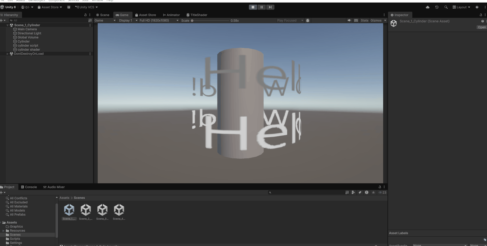
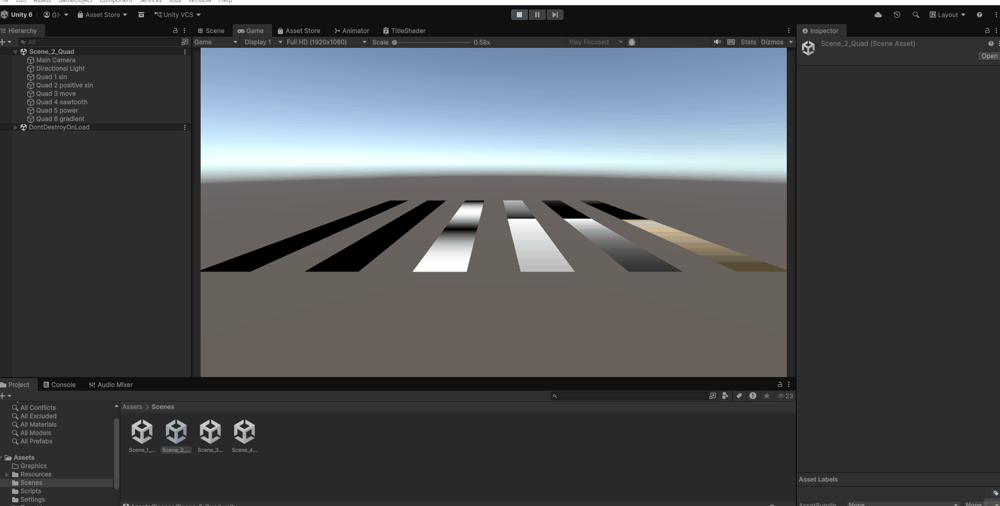
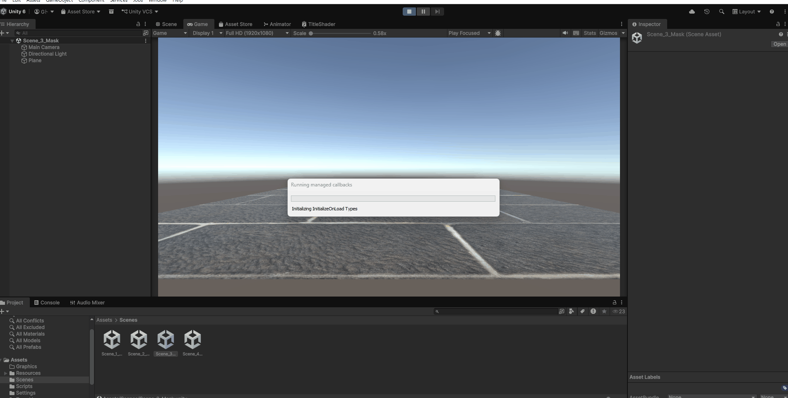
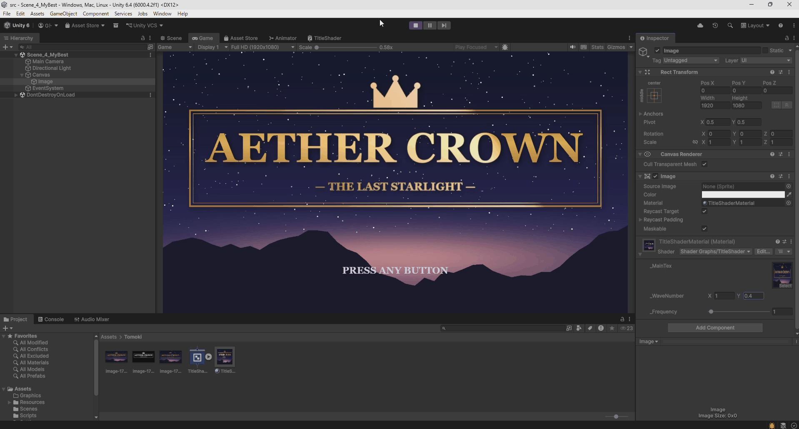

# はじめに
プログラムワークショップIVの管理用です

# 結果画像

- 工夫した点：Canvas用のShaderGraphで架空のゲームのタイトルロゴを光らせてみました。（画像については生成AIを使用しています。） UVと時間で作った波をFractionとSampleGradientで光の帯にし、背景画像のアルファをマスクとして掛けることで、金色のロゴ部分だけが光るようにしています。

# 進め方

- 本リポジトリをforkしてください
- fork先のリポジトリを更新してください
- Unityのプロジェクトをsrc内で進めてください
- 結果を画面キャプチャして、画像としてリポジトリに追加して、上記のリンクから見られるようにしてください
- 完成したら本リポジトリのmainブランチにpull requestを投げてください
